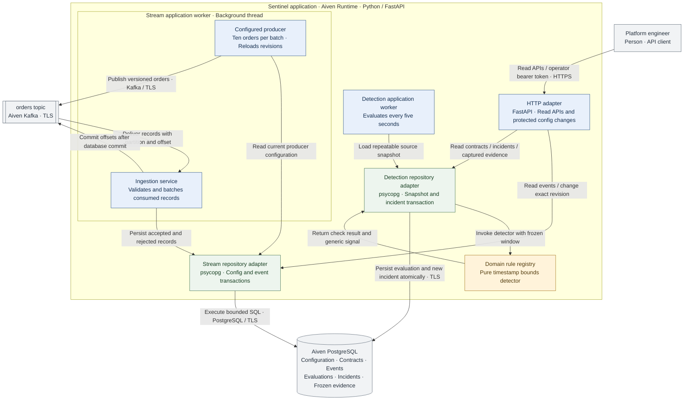

# Sentinel runtime components

This view shows execution flow for the implemented slices. Every box inside the Runtime boundary runs in the same Python process. The arrows describe runtime calls and data movement.

The domain detector performs no I/O and no mutation. A signal identifies the rule, fields, window, observed/expected values and evidence IDs. The repository obtains a consistent source view and persists the result inside one transaction. A database uniqueness constraint suppresses repeated active episodes, and append-only triggers protect captured source versions and evidence.

The rule registry is an extension point for additional checks. The future action registry is a separate boundary: detecting a new rule will not automatically authorize a new kind of repair.
