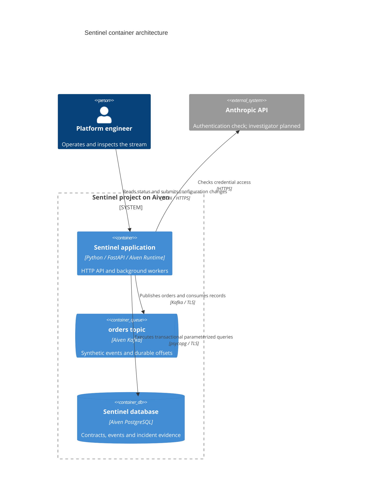

# Sentinel containers

There is one deployable application, one Kafka topic and one database. Workers and detector functions are components within the application, rather than separate services.

One Runtime instance and one Uvicorn worker are the supported deployment shape. Two background threads keep ingestion and contract evaluation independent. The existing Grafana service will later read restricted PostgreSQL views; it will have no action-execution role.
