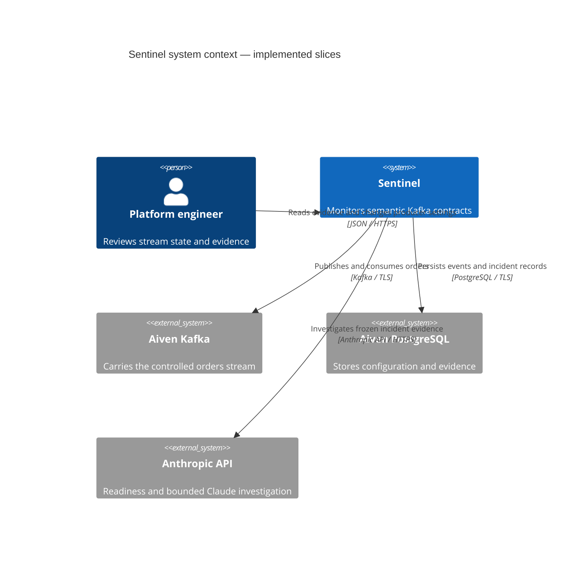

# Sentinel system context

Sentinel is a contract-monitoring system for a platform engineer. The current implementation publishes a controlled synthetic stream and records violations. Investigation, approval and repair remain planned.

The engineer controls producer configuration through an authenticated API. Contract expectations are versioned independently of that configuration. A producer change cannot silently change the expected unit.
