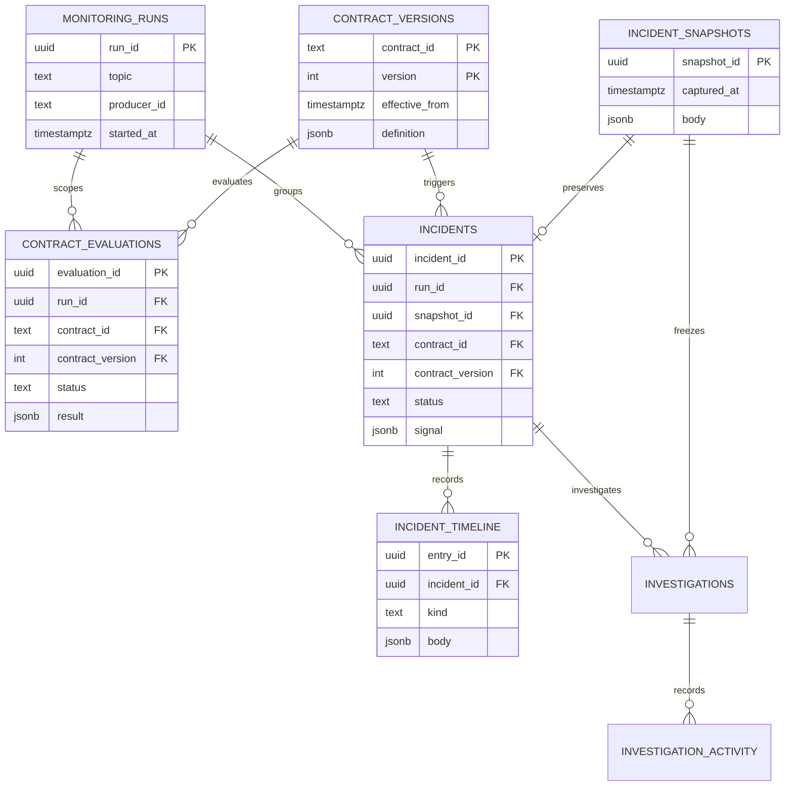

# PostgreSQL records

The ingestion and detection slices use thirteen application tables in the `sentinel` schema and one migration table in `public`. Detection tables come from `002_detection.sql`; investigation runs and tool activity come from `003_investigation.sql`. Live fault-to-investigation verification remains pending.

| Table | Records | Purpose |
|---|---|---|
| `sentinel.producer_configurations` | Current producer unit, revision and update time | Controls actual emitted events |
| `sentinel.producer_configuration_history` | Revision, previous/new unit, reason, actor and time | Attributes events to recorded producer changes |
| `sentinel.events` | Validated JSON event, raw business timestamp, Kafka coordinates/time, producer/build/config revision and ingestion time | Feeds detection and supplies original event evidence |
| `sentinel.rejected_records` | Original malformed bytes, Kafka coordinates/time, ingestion time and rejection reason | Retains invalid messages while allowing ingestion to continue |
| `sentinel.contract_versions` | Contract identity, version, topic, effective time and declarative JSON definition | Preserves expected semantics independently of producer behavior |
| `sentinel.producer_context_versions` | Producer ownership and consumer expectations as versioned JSON | Grounds investigation in declared context; initial metadata is synthetic |
| `sentinel.monitoring_runs` | Topic, producer, run identity and start/end time | Groups monitoring episodes across process restarts |
| `sentinel.contract_evaluations` | Evaluation time, rule, contract version, state, sample counts, profiles and optional signal | Records healthy, warming-up, stale and violating checks |
| `sentinel.incident_snapshots` | Captured time and immutable JSON evidence body | Makes investigation reproducible after live sources change |
| `sentinel.incidents` | Violation episode, status, triggering contract, signal and snapshot reference | Suppresses repeated active incidents and preserves incident identity |
| `sentinel.incident_timeline` | Append-only typed incident entries | Starts with detection and later supports investigation, decisions, actions and recovery |
| `sentinel.investigations` | Queue state, frozen snapshot reference, pinned model/agent version, token budget, finding, failure, duration and usage | Records each original attempt and explicit retry; terminal results are not overwritten by workers |
| `sentinel.investigation_activity` | Append-only tool-call ID, name, start/result, timestamp and actual arguments/result | Supports live polling and later review without recording private chain-of-thought |
| `public.sentinel_migrations` | Migration filename and application time | Applies schema changes once under a transaction lock |

The diagram shows database-enforced relationships for the detection records. Event-to-configuration revision references are logical references rather than foreign keys: ingestion preserves messages even when their configuration history is unavailable. Snapshot JSON carries the actual bounded event and source-version copies, so later reads do not substitute current records. Missing configuration revisions are recorded explicitly.

Accepted event `payload` is validated JSONB, rather than a byte-for-byte copy of the original message. Rejected payloads retain their original bytes. Event IDs and Kafka coordinates have independent uniqueness constraints. Contract/context versions, snapshots and timeline entries reject updates and deletes.

Secrets remain in environment variables. No retention job exists yet. Agent investigations, proposals, approvals, executions and recovery proofs remain future record groups; they are not implied by the current incident table.
